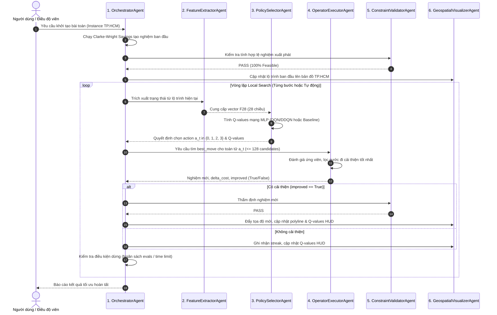

# AGENTS.md — HƯỚNG DẪN & QUY TẮC PHỐI HỢP ĐA TÁC TỬ
## DỰ ÁN: DQN-CVRP — HỌC CHỌN TOÁN TỬ LOCAL SEARCH BẰNG DEEP Q-LEARNING
**Tác giả:** Phan Tấn Phát, Hà Trọng Khiêm, Nguyễn Trí Anh — Nhóm 10, Đại học FPT TP. Hồ Chí Minh

---

Tài liệu này xác lập hai mục tiêu chính:
1. **Chỉ dẫn phát triển (Developer Agent Guide)** dành cho các AI Coding Assistants (Cursor, Claude Code, Antigravity, GitHub Copilot) khi làm việc trên kho mã nguồn `dqn-cvrp`.
2. **Đặc tả kiến trúc tác tử thực thi (Runtime Multi-Agent Architecture)** cho hệ thống điều độ định tuyến phương tiện và biểu diễn trực quan trên Bản đồ TP. Hồ Chí Minh.

---

## 1. NGUYÊN TẮC BẤT BIẾN CỐT LÕI (CORE INVARIANTS)

Bất kỳ thay đổi mã nguồn, tính năng mới, hoặc thao tác tái cấu trúc nào đều **bắt buộc tuân thủ 4 quy tắc bất biến** sau:

```text
+----------------------------------------------------------------------------------+
|                              4 BẤT BIẾN CỦA DỰ ÁN                               |
+----------------------------------------------------------------------------------+
| 1. BẢO TOÀN TẢI TRỌNG (Feasibility): Mọi tuyến r phải có sum(q_i) <= Q.          |
| 2. PHỤC VỤ DUY NHẤT (Uniqueness): Mỗi khách hàng 1..n xuất hiện đúng một lần.   |
| 3. KHÉP KÍN DEPOT (Cycle Closure): Tuyến đường luôn bắt đầu và kết thúc tại 0.  |
| 4. TRUY NGUYÊN THỰC NGHIỆM (Reproducibility): Cùng hạt giống RNG, cùng ngân sách |
+----------------------------------------------------------------------------------+
```

### Chi tiết các ràng buộc:
- **Tuyệt đối không sinh nghiệm không khả thi**: Không có bất kỳ ngoại lệ nào chấp nhận nghiệm vi phạm sức chứa xe ($\text{Load}(R_k) > Q$) hoặc vượt quá số xe tối đa ($|\mathcal{R}| > K$). Module `ConstraintValidatorAgent` phải luôn trả về `status: "PASS"`.
- **Cải thiện nghiêm ngặt (Strict Improvement)**: Trong vòng lặp Local Search, một nước đi của toán tử chỉ được chấp nhận khi:
  $$\Delta \mathcal{C} = \mathcal{C}_{\text{current}} - \mathcal{C}_{\text{candidate}} > 0$$
  Nếu $\Delta \mathcal{C} \le 0$, giữ nguyên nghiệm hiện tại và ghi nhận chuỗi không cải thiện (`streak`).
- **Trung thực khoa học (Anti-Slop Research Honesty)**: Báo cáo và mã nguồn phải phản ánh chính xác kết quả đo đạc: DQN không vượt qua baseline đơn giản (Random, Cyclic, Greedy) do 3 lý do khách quan đã được chứng minh (Dư địa nhỏ $0.56\% - 1.23\%$, Lệch miền đặc trưng $A2 \to A3$, Chi phí suy luận CPU $0.27\text{ ms}$ vs $0.10\text{ ms}$). Không ngụy tạo kết quả hoặc đưa ra nhận định phóng đại.

---

## 2. QUY CHUẨN MÃ NGUỒN VÀ PHONG CÁCH KỸ THUẬT (ENGINEERING STANDARDS)

- **Ngôn ngữ & Nền tảng**: Python 3.10+, PyTorch cho DRL, FastAPI cho backend, Leaflet.js thuần cho frontend (không lạm dụng framework cồng kềnh).
- **Tránh "Code Slop"**:
  - Không tạo các tầng trừu tượng giả (no unnecessary factories, managers of managers, or pseudo-wrappers).
  - Không viết code mẫu thừa mống (boilerplate) không dùng đến.
  - Sử dụng Type Hints chuẩn (`typing.List`, `typing.Tuple`, `typing.Dict`, `Optional`).
  - Đặt tên biến tường minh theo ký hiệu toán học bài toán: `routes`, `demands`, `capacity`, `evals_used`, `delta_cost`.
- **Quy trình kiểm thử**: Mọi chỉnh sửa thuật toán phải pass toàn bộ test suite:
  ```powershell
  python -m pytest tests/ -v
  ```

---

## 3. KIẾN TRÚC ĐA TÁC TỬ CHO BẢN ĐỒ PRODUCTION TP. HỒ CHÍ MINH

Hệ thống điều độ trên bản đồ TP.HCM được tổ chức thành 6 tác tử chuyên trách (Specialized Agents) phối hợp theo luồng sự kiện tuần tự:



### Chi tiết vai trò của từng Tác tử:

### 3.1. `OrchestratorAgent` (Tác tử Điều phối Hệ thống)
- **Trách nhiệm**: Quản lý vòng đời tối ưu hóa, nạp dữ liệu địa lý TP.HCM (tọa độ GPS Kho trung tâm tại ĐH FPT và các điểm giao hàng quận huyện), khởi tạo nghiệm ban đầu bằng Clarke-Wright, theo dõi ngân sách tìm kiếm (`evals_used`, `elapsed_time`) và điều kiện dừng.
- **Quy tắc**: Không trực tiếp sửa đổi tọa độ hay thứ tự node mà phải ủy quyền cho `OperatorExecutorAgent`.

### 3.2. `FeatureExtractorAgent` (Tác tử Trích xuất Đặc trưng $F28$)
- **Trách nhiệm**: Biến đổi trạng thái đồ họa tuyến đường thành vector số học chuẩn 28 chiều ($s_t \in \mathbb{R}^{28}$):
  - 12 đặc trưng toàn cục: tỷ lệ tải trọng trung bình, độ lệch chuẩn tải, tỷ lệ xe đầy nhất/ít nhất, số xe chuẩn hóa, độ dài tuyến, tiến độ ngân sách, tỷ lệ cải thiện tích lũy.
  - 16 đặc trưng lịch sử: 4 chỉ số $\times$ 4 toán tử (tỷ lệ thành công gần đây, mức cải thiện trung bình, tần suất được chọn, chuỗi không cải thiện chuẩn hóa với `feature_patience = 30`).
- **Quy tắc**: Đảm bảo mọi giá trị trong vector nằm trong khoảng xác định hữu hạn, không chứa `NaN` hay `Inf`.

### 3.3. `PolicySelectorAgent` (Tác tử Ra Quyết định Chính sách)
- **Trách nhiệm**: Nhận vector $F28$ và chọn toán tử tiếp theo $a_t \in \{0, 1, 2, 3\}$:
  - `0`: 2-opt (đảo ngược phân đoạn cùng tuyến).
  - `1`: intra-relocate (dời khách hàng trong cùng tuyến).
  - `2`: inter-relocate (chuyển khách hàng sang tuyến khác).
  - `3`: inter-swap (đổi chỗ hai khách hàng giữa hai tuyến).
- **Hỗ trợ các chế độ**:
  - `DQN`: Chọn $\arg\max_a Q(s, a)$.
  - `Double DQN`: Tách riêng mạng chọn và mạng đánh giá để khử bias.
  - `Greedy`: Thử nghiệm nhanh các toán tử và chọn toán tử cho $\Delta C$ tức thời cao nhất.
  - `Cyclic`: Xoay vòng tuần tự $0 \to 1 \to 2 \to 3 \to 0$.
  - `Random`: Lấy mẫu ngẫu nhiên đều.

### 3.4. `OperatorExecutorAgent` (Tác tử Thực thi Toán tử Cục bộ)
- **Trách nhiệm**: Sinh và đánh giá tập ứng viên cục bộ (tối đa $\le 128$ candidates) cho toán tử được chỉ định.
- **Quy tắc**:
  - Với `inter-relocate` và `inter-swap`: bắt buộc kiểm tra điều kiện sức chứa tải trọng trước khi tính toán chi phí. Nếu vượt $Q$, lập tức loại bỏ ứng viên mà không áp dụng.
  - Chọn ứng viên có $\Delta C > 0$ lớn nhất.

### 3.5. `ConstraintValidatorAgent` (Tác tử Thẩm định Độc lập)
- **Trách nhiệm**: Hoạt động như một kiểm toán viên độc lập (Independent Auditor). Sau mỗi lần cập nhật nghiệm, tác tử này đọc danh sách tuyến đường và tính lại từ đầu khoảng cách dựa trên công thức Haversine mặt cầu, xác nhận 100% tính khả thi.

### 3.6. `GeospatialVisualizerAgent` (Tác tử Trực quan hóa Bản đồ TP.HCM)
- **Trách nhiệm**: Chuyển đổi dữ liệu danh sách đỉnh $0 \to c_1 \dots c_p \to 0$ thành các đối tượng Polyline trên nền bản đồ Leaflet.js của TP. Hồ Chí Minh.
- **Quy tắc hiển thị**:
  - Mỗi xe một màu nhận diện riêng biệt (Xanh dương, Cam, Xanh lá, Đỏ, Tím, Vàng, Ngọc bích,...).
  - Depot Đại học FPT TP.HCM tại Khu Công nghệ Cao TP. Thủ Đức hiển thị với biểu tượng nổi bật và tọa độ chuẩn $(10.8415^\circ\text{N}, 106.8098^\circ\text{E})$.
  - Cập nhật thông số HUD thời gian thực: Cự ly tổng (km), Tỷ lệ tiết kiệm (%), Số xe hoạt động, Q-values.

---

## 4. QUY TRÌNH LÀM VIỆC CỦA AGENT KHI THỰC HIỆN TÁC VỤ (WORKFLOW RULES)

Khi một AI coding agent nhận yêu cầu phát triển hoặc bảo trì repo:
1. **Trước khi sửa code**: Đọc kỹ `docs/PRD.md` và `docs/TECH_ARCHITECTURE.md` để nắm chắc yêu cầu nghiệp vụ và công thức toán.
2. **Khi lập trình thuật toán**: Giữ tính module hóa cao trong thư mục `src/cvrp/` và `src/agents/`.
3. **Khi xây dựng giao diện Web Demo**:
   - Menu điều hướng bên trái phải đóng mở mượt mà bằng CSS transitions.
   - Bản đồ TP.HCM phải hiển thị trọn vẹn, không bị vỡ layout khi co giãn cửa sổ.
4. **Trước khi kết thúc tác vụ**: Chạy kiểm thử tự động, xác nhận không có lỗi import hay gãy logic hồi quy.

