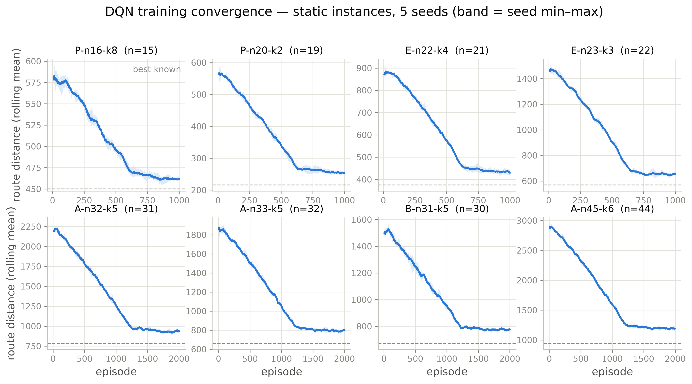
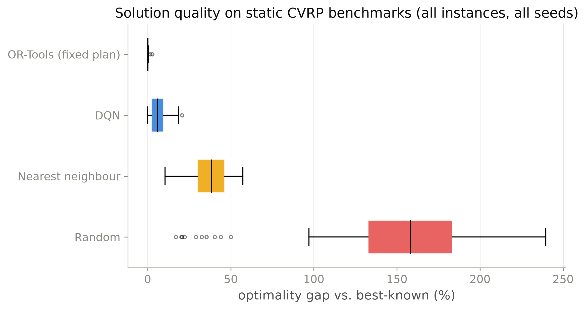
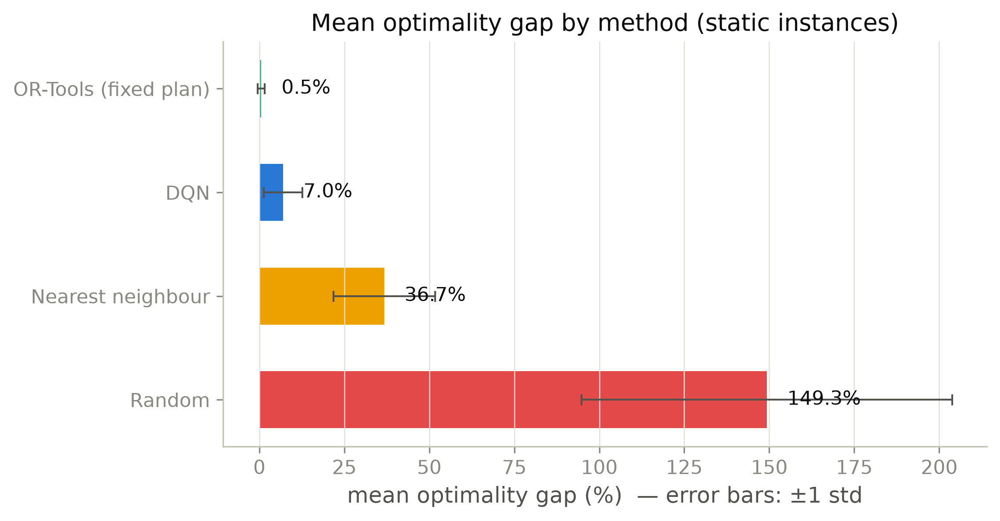
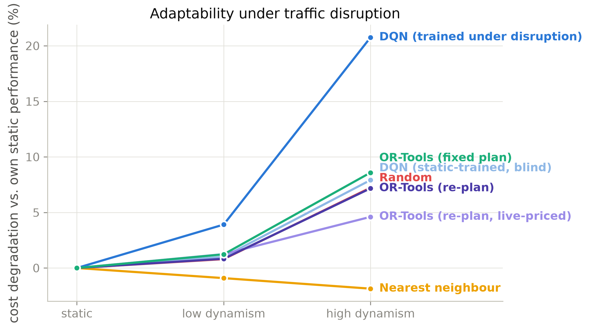
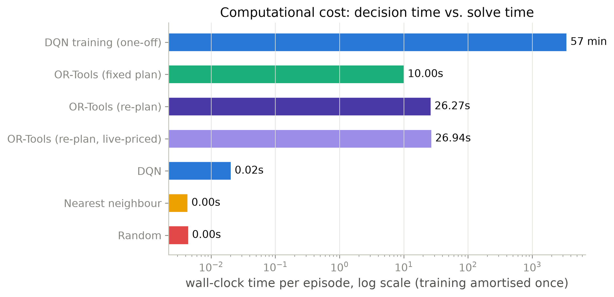
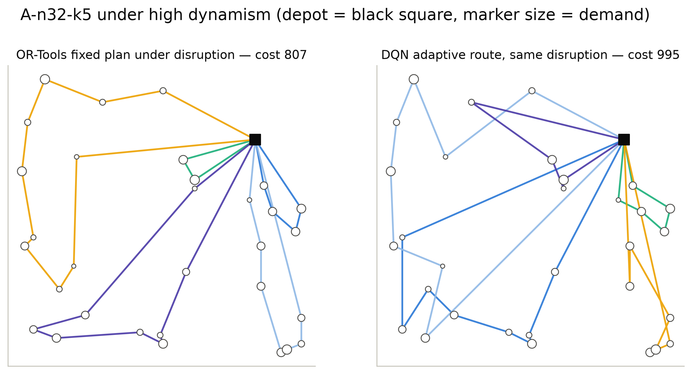

# Results and Statistical Analysis

## Overview

This document presents the experimental findings from the evaluation of **Deep Reinforcement Learning for Dynamic Route Optimisation**.

The analysis compares a masked **Double Deep Q-Network (Double DQN)** with classical optimisation and heuristic routing approaches across established CVRPLIB benchmark instances.

The results are interpreted around three questions:

1. Does the DQN learn meaningful routing behaviour?
2. How does its solution quality compare with heuristic and optimisation baselines?
3. How robust is the learned policy when travel conditions become increasingly dynamic?

The findings show a nuanced result rather than a simple claim that one method dominates all others.

> **The DQN substantially improves upon simple heuristic/random routing behaviour and demonstrates fast learned decision-making, while Google OR-Tools remains stronger in absolute routing solution quality within the evaluated benchmark setting.**

---

# 1. Evaluation Conditions

The experimental evaluation covers three operating conditions:

| Condition | Description |
|---|---|
| Static | No travel-cost disruption |
| Low disruption | Moderate stochastic changes to travel costs |
| High disruption | Stronger stochastic changes to travel costs |

The primary comparisons involve:

- Double DQN;
- OR-Tools fixed planning;
- OR-Tools re-planning;
- OR-Tools live re-planning;
- nearest-neighbour routing; and
- random routing.

Experiments are conducted across eight CVRPLIB benchmark instances.

---

# 2. Results at a Glance

A useful high-level comparison is the mean route distance achieved by the principal methods.

Lower route distance indicates better routing performance.

| Condition | DQN | Nearest Neighbour | OR-Tools Fixed |
|---|---:|---:|---:|
| Static | **630.65** | 815.50 | **588.63** |
| Low disruption | **657.03** | 808.85 | **595.30** |
| High disruption | **769.07** | 791.92 | **637.50** |

These results reveal two important patterns.

First, the DQN provides considerably stronger routing behaviour than nearest-neighbour in the static and low-disruption experiments.

Second, OR-Tools retains the strongest absolute solution quality across these comparisons.

This is important for interpreting the contribution of the research correctly.

The experiments do **not** establish that Deep Reinforcement Learning universally replaces classical optimisation.

Instead, they expose the different strengths and limitations of learned and optimisation-based routing approaches.

---

# 3. DQN vs Nearest-Neighbour

The nearest-neighbour heuristic provides an important comparison because it represents a simple, computationally lightweight routing strategy.

## Static Environment

Mean route distance:

| Method | Mean Distance |
|---|---:|
| DQN | **630.65** |
| Nearest Neighbour | 815.50 |

Wilcoxon signed-rank test:

```text
p = 0.007812
```

The paired comparison indicates that the DQN produced consistently lower route costs than nearest-neighbour across the evaluated benchmark instances.

At the conventional 0.05 significance level, this difference is statistically significant.

This provides evidence that the learned policy has acquired routing behaviour that is substantially more effective than the simple greedy heuristic under static conditions.

---

## Low Disruption

Mean route distance:

| Method | Mean Distance |
|---|---:|
| DQN | **657.03** |
| Nearest Neighbour | 808.85 |

Wilcoxon signed-rank test:

```text
p = 0.007812
```

The DQN again achieves a lower mean route distance.

The paired difference remains statistically significant at the conventional 0.05 level.

This suggests that the learned policy retains useful routing behaviour when moderate stochastic changes are introduced into travel conditions.

---

## High Disruption

Mean route distance:

| Method | Mean Distance |
|---|---:|
| DQN | **769.07** |
| Nearest Neighbour | 791.92 |

Wilcoxon signed-rank test:

```text
p = 0.3125
```

Although the DQN retains a lower mean distance in this comparison, the difference is substantially smaller.

The Wilcoxon test does not provide evidence of a statistically significant difference at the conventional 0.05 level.

This is an important result.

It suggests that the relative advantage of the learned policy becomes less clear as the level of travel disruption increases.

---

# 4. DQN vs OR-Tools

Google OR-Tools provides a much stronger baseline than nearest-neighbour.

This comparison therefore provides a more demanding assessment of the learned policy.

## Static Environment

| Method | Mean Distance |
|---|---:|
| DQN | 630.65 |
| OR-Tools Fixed | **588.63** |

Wilcoxon comparison:

```text
p = 0.007812
```

OR-Tools achieves lower route costs across the benchmark comparison.

This demonstrates that classical optimisation remains highly competitive when the routing problem is well specified.

---

## Low Disruption

| Method | Mean Distance |
|---|---:|
| DQN | 657.03 |
| OR-Tools Fixed | **595.30** |

The optimisation baseline continues to achieve better absolute route quality.

The difference also shows that introducing moderate dynamism does not automatically make the learned policy superior to classical optimisation.

---

## High Disruption

| Method | Mean Distance |
|---|---:|
| DQN | 769.07 |
| OR-Tools Fixed | **637.50** |

The gap becomes more pronounced under stronger disruption in this comparison.

This is useful negative evidence.

Rather than hiding this result, the project treats it as an important research finding: **training a DQN under dynamic conditions does not automatically guarantee robustness superior to a strong optimisation baseline.**

---

# 5. Training Convergence

The training pipeline records learning behaviour across the experimental configuration.



The convergence figure provides evidence of how policy performance evolves during training.

Because reinforcement learning can exhibit considerable variability, convergence should not be interpreted solely from a single training trajectory.

The use of multiple seeds provides a more reliable view of training behaviour.

---

# 6. Optimality Gap

Solution quality can also be evaluated relative to the best-known benchmark solutions.

The optimality gap measures how far an evaluated solution is from the best-known reference cost.

Conceptually:

```text
Optimality Gap (%) =
((Method Cost - Best-Known Cost) / Best-Known Cost) × 100
```

Lower values indicate better performance.

---

## Optimality Gap Distribution



The distribution illustrates variation in performance across benchmark instances and methods.

It also demonstrates why reporting only an overall mean can be misleading: different benchmark instances can produce substantially different relative performance.

---

## Optimality Gap by Method



The comparison reinforces the strength of the optimisation baseline while showing that the learned policy performs considerably above the simplest routing strategies.

---

# 7. Adaptability Under Dynamic Conditions

One of the central objectives of the research is to investigate behaviour when routing costs change during execution.



The analysis compares performance as the environment moves from:

```text
Static → Low Disruption → High Disruption
```

Increasing disruption generally makes the routing problem more difficult.

However, the magnitude of degradation differs across methods.

---

# 8. DQN Degradation

For DQN policies trained under the corresponding dynamism level, mean degradation was approximately:

| Disruption Level | Mean Degradation |
|---|---:|
| Low | **3.91%** |
| High | **20.75%** |

The increase under high disruption demonstrates that stronger stochastic variation substantially affects routing performance.

---

# 9. Cross-Evaluation Observation

An interesting result appears when a static DQN policy is evaluated under dynamic conditions.

Approximate degradation was:

| Evaluation Condition | Mean Degradation |
|---|---:|
| Low disruption | **1.00%** |
| High disruption | **7.92%** |

This result is particularly interesting because it challenges a simple assumption:

> Training under more dynamic conditions does not necessarily produce a more robust learned policy.

The result suggests that the relationship between training noise and generalisation deserves further investigation.

Possible explanations include:

- increased difficulty of the training distribution;
- instability introduced by highly variable travel costs;
- limitations of the state representation;
- limitations of the DQN architecture; or
- insufficient training exposure for learning robust responses.

These possibilities are potential directions for future research rather than conclusions established by the present experiments.

---

# 10. Runtime Analysis

Routing quality is not the only relevant metric.

Computational cost is particularly important in dynamic optimisation because decisions may need to be made repeatedly while conditions are changing.



The fundamental computational difference is:

### Classical Optimisation

OR-Tools performs a search procedure to construct or reconstruct a routing solution.

If conditions change frequently, optimisation may need to be repeated.

### Learned Policy

Once training has been completed, the DQN selects actions through neural-network inference.

The expensive learning process occurs before deployment.

This means that a learned policy can potentially provide rapid sequential decisions after training.

The experiments therefore expose a trade-off:

> **OR-Tools provides stronger solution quality, while learned neural inference offers a different computational profile that may become relevant in decision environments requiring rapid repeated actions.**

This trade-off is more informative than simply asking which algorithm achieves the lowest route distance.

---

# 11. Example Routing Behaviour

Example routes generated during the evaluation are shown below.



Route visualisation provides a qualitative complement to the numerical evaluation.

It helps identify differences in routing structure that may not be immediately visible from aggregate performance metrics.

---

# 12. Statistical Evaluation

The project uses statistical analysis to reduce reliance on descriptive averages alone.

The analysis includes:

- Wilcoxon signed-rank tests;
- rank-biserial effect sizes;
- bootstrap confidence intervals;
- descriptive statistics; and
- degradation analysis.

Generated statistical outputs are stored in:

```text
results/stats_summary.csv
results/wilcoxon.csv
results/degradation.csv
```

---

# 13. Why Statistical Testing Matters

Machine-learning experiments can produce apparent performance differences simply because of random variation.

This is especially relevant for reinforcement learning because results may depend on:

- network initialisation;
- exploration;
- replay sampling;
- environment stochasticity; and
- benchmark characteristics.

Statistical analysis therefore provides additional evidence about whether observed differences are consistent across paired benchmark evaluations.

---

# 14. Interpretation of p-values

A result such as:

```text
p = 0.007812
```

provides evidence against the null hypothesis of no systematic paired difference under the assumptions of the Wilcoxon analysis.

It should not be interpreted as the probability that one algorithm is correct or superior.

Similarly:

```text
p = 0.3125
```

does not prove that two methods are identical.

It indicates that the available paired observations do not provide sufficient evidence to reject the null hypothesis at the selected significance threshold.

This distinction is important when interpreting results from a relatively small benchmark set.

---

# 15. Effect Size

Statistical significance does not by itself describe the magnitude of a difference.

The analysis therefore also calculates rank-biserial effect sizes.

Effect-size reporting helps distinguish between:

- statistically detectable differences; and
- differences that are practically substantial.

The complete values are available in:

```text
results/wilcoxon.csv
```

---

# 16. Bootstrap Confidence Intervals

Bootstrap confidence intervals provide another way of representing uncertainty around experimental differences.

Rather than presenting a single point estimate as perfectly precise, the bootstrap analysis estimates a range of plausible values based on resampling the available observations.

This is especially useful in research settings where the number of benchmark instances is limited.

---

# 17. Main Findings

The experimental evidence supports several key findings.

### Finding 1 — The DQN learned meaningful routing behaviour

The DQN substantially outperformed the simple nearest-neighbour comparison in static and low-disruption conditions.

The paired Wilcoxon comparisons produced:

```text
p = 0.007812
```

for both conditions.

---

### Finding 2 — OR-Tools remained stronger in absolute routing quality

The classical optimisation baseline achieved lower mean route distance than the DQN across the principal static and dynamic comparisons.

This means the results do not support a claim that DQN universally replaces classical optimisation.

---

### Finding 3 — High disruption remains challenging

The DQN's advantage over nearest-neighbour became much less clear under high disruption.

The corresponding comparison produced:

```text
p = 0.3125
```

indicating that the available paired results do not establish a statistically significant difference.

---

### Finding 4 — Dynamic training did not automatically improve robustness

Cross-evaluation showed that a policy trained under stronger dynamic conditions did not necessarily degrade less when evaluated under disruption.

This provides a useful direction for future investigation into robustness and distribution shift.

---

### Finding 5 — Solution quality is only one part of the comparison

The learned DQN and classical optimisation approaches have fundamentally different computational characteristics.

OR-Tools performs optimisation during planning/re-planning.

The trained DQN instead performs neural inference.

Future work should therefore investigate when the computational advantage of learned inference becomes practically important enough to justify some reduction in route quality.

---

# 18. What the Results Do Not Establish

The experiments do **not** demonstrate that:

- DQN universally outperforms OR-Tools;
- reinforcement learning is always preferable for vehicle routing;
- the trained policies generalise to arbitrary unseen routing instances;
- the dynamic environment captures every real-world logistics disruption; or
- the current architecture is optimal for dynamic CVRP.

Avoiding these claims is important for maintaining a rigorous interpretation of the research.

---

# 19. Research Implications

The results suggest that the most promising direction may not be treating **Deep Reinforcement Learning and classical optimisation as mutually exclusive alternatives**.

Instead, future systems could investigate hybrid approaches.

For example:

```text
Classical Optimisation
        +
Learned Decision Policy
        +
Uncertainty Estimation
        ↓
Adaptive Routing System
```

Potential hybrid strategies include:

- using learned policies to warm-start optimisation;
- using optimisation to supervise policy learning;
- allowing DRL to make rapid decisions between optimisation cycles;
- invoking expensive optimisation only when uncertainty becomes high; or
- combining graph-based neural representations with classical constraints.

This represents a natural extension of the present research.

---

# 20. Overall Conclusion

The experiments demonstrate that Deep Reinforcement Learning can learn non-trivial routing behaviour within the implemented CVRP framework.

The Double DQN performs substantially better than simple routing baselines under several experimental conditions and offers rapid learned decision-making after training.

However, classical OR-Tools optimisation remains stronger in absolute routing quality across the evaluated benchmark setting.

The most important conclusion is therefore not that one paradigm universally replaces the other.

Instead:

> **The research demonstrates the value of systematically studying the trade-off between learned sequential decision-making, classical optimisation, computational efficiency, and robustness under changing conditions.**

This provides a foundation for future research into **adaptive optimisation, hybrid AI systems, uncertainty-aware decision making, and robust reinforcement learning**.

---

## Data Behind the Analysis

The numerical results used in this analysis are available under:

```text
results/
```

including:

```text
results_master.csv
stats_summary.csv
wilcoxon.csv
degradation.csv
cross_eval.csv
baselines_static.csv
```

This allows the reported findings to be independently inspected and re-analysed.

---

## Related Documentation

For the underlying research design:

**[Research Methodology](methodology.md)**

For the complete experimental setup:

**[Experimental Design](experiments.md)**

For instructions to recreate the experiments:

**[Reproducibility Guide](reproducibility.md)**

For limitations and research extensions:

**[Limitations and Future Research](limitations.md)**

Return to:

**[Project README](../README.md)**