# TÀI LIỆU KIẾN TRÚC KỸ THUẬT (TECHNICAL ARCHITECTURE)
## DỰ ÁN: MP-MOTO-CVRP (V9.3) — HỆ THỐNG ĐIỀU PHỐI ĐỘI XE MÁY TP.HCM BẰNG DEEP REINFORCEMENT LEARNING

---

## 1. TỔNG QUAN KIẾN TRÚC HỆ THỐNG (SYSTEM OVERVIEW)

Hệ thống được thiết kế theo mô hình phân tầng mô-đun hóa nghiêm ngặt (**Modular Layered Architecture**), phân tách thành 5 tầng độc lập tuân thủ nguyên tắc **Single Source of Truth** (SSOT):

```mermaid
flowchart TD
    subgraph DataLayer["1. Tầng Dữ liệu & Đồ thị OSM (Data Foundation)"]
        OSM_Graph["Đồ thị Đường xe máy TP.HCM (OSMnx/NetworkX)<br/>602 Nút | 11.408 Cạnh có hướng (1 SCC duy nhất)"]
        DB_Stores["Cơ sở dữ liệu: 570 Cửa hàng (19 Quận)<br/>Tên đường thật + Tọa độ trong Bounding Box"]
        DB_Depots["Cơ sở dữ liệu: 20 Kho trung chuyển TP.HCM<br/>Inner City, Outer Ring, Logistics Hub"]
        Precalc_Matrix["Bộ đệm Ma trận: dist_m.npy & time_s.npy<br/>Dijkstra đa nguồn có hướng (590 x 590)"]
    end

    subgraph CoreLayer["2. Tầng Lõi CVRP & Môi trường Gym (Core Engine)"]
        Env["MotorbikeCVRPEnv (Gymnasium API)<br/>State F28 (28D) | Action Masking"]
        CW_Init["Clarke-Wright Savings Initializer<br/>100% Feasible Capacity Allocation"]
        Operators["4 Toán tử Local Search (Candidates <= 128)<br/>0: 2-opt | 1: Intra-relocate<br/>2: Inter-relocate (<= Q) | 3: Inter-swap (<= Q)"]
        FeasibilityGate["Cổng Thẩm định 4 Tầng (Feasibility Gate)<br/>Check Count | Item Load | Total Cap | Bin-Packing FFD"]
    end

    subgraph ModelLayer["3. Tầng Mô hình Giải thuật (3 Solvers Suite)"]
        Solver_CW["Mô hình 1: CW + Greedy<br/>Clarke-Wright + Heuristic Local Search"]
        Solver_Base["Mô hình 2: DDQN Gốc (Base Stage-1)<br/>MLP 28->128->128->4 (Toán tử Cục bộ)"]
        Solver_Fine["Mô hình 3: Neural LNS (RL Destroy & Repair)<br/>State 36D -> 6 Vĩ toán tử -> Vượt trội Baseline"]
    end

    subgraph ServiceLayer["4. Tầng Dịch vụ & REST API (FastAPI Backend)"]
        MatrixMgr["MatrixManager (Tái tạo Geometry legs[])<br/>Lookup O(1) + Reconstruct Tim đường"]
        DispatchAPI["Endpoints:<br/>POST /api/dispatch-motorbike<br/>GET /api/motorbike/depots<br/>GET /api/motorbike/stores<br/>POST /api/motorbike/snap"]
    end

    subgraph UILayer["5. Tầng Giao diện Tối giản Chuẩn Apple (Minimalist Web App)"]
        NavTabs["Tầng 1: Underline Tabs (Điều phối | Lộ trình | Đối chiếu)"]
        SegControl["Tầng 2: Segmented Control (3 Mô hình)"]
        MapLeaflet["Leaflet.js Map: Polyline Single Source of Truth<br/>Mô phỏng xe máy bám tim đường sai số <= 3.2m"]
        HUD_Q["HUD Capsule + Thanh Monoline Q-Values 3px"]
    end

    DataLayer --> CoreLayer
    DataLayer --> ServiceLayer
    CoreLayer --> ModelLayer
    ModelLayer --> ServiceLayer
    ServiceLayer <--> UILayer
```



---

## 2. KIẾN TRÚC ĐỒ THỊ ĐƯỜNG BỘ & BẢO ĐẢM TÍNH LIÊN THÔNG (GRAPH FOUNDATION)

### 2.1. Đồ thị Đường xe máy TP.HCM (HCMC Motorbike Directed Graph)
- **Đồ thị có hướng:** $G = (V, E)$ trong đó $V$ là tập các nút giao thông và $E$ là tập các đoạn đường có hướng cho phép xe máy lưu thông.
- **Quy mô chuẩn hóa:** 602 đỉnh (nodes) và 11.408 cạnh có hướng (edges).
- **Hành lang kết nối (Arterial Corridor Connectors):** Nhằm khắc phục các rào cản địa lý tự nhiên tại TP.HCM (như Sân bay Tân Sơn Nhất ngăn cách Gò Vấp - Quận 12 hay Sông Sài Gòn ngăn cách Quận 1 - TP. Thủ Đức), thuật toán xây dựng đồ thị (`scripts/build_dataset.py`) tự động nối các cặp nút gần nhất giữa các thành phần liên thông rời rạc cho đến khi toàn bộ đồ thị hội tụ về **1 thành phần liên thông mạnh duy nhất (Strongly Connected Component - SCC)**.
- **Bảo đảm định tuyến:** Mọi điểm bất kỳ trong đồ thị đều có đường đi có hướng đến mọi điểm khác, loại bỏ hoàn toàn lỗi "không tìm thấy đường đi" (`NetworkXNoPath`).

### 2.2. Cơ sở Dữ liệu 570 Cửa hàng & 20 Kho Trung chuyển
- **570 Cửa hàng (`data/db/stores.json`):** Phân bổ đều trên 19 quận/huyện. Tên đường và tên quận được trích xuất đồng bộ từ thuộc tính `edge['name']` của OpenStreetMap, bảo đảm 100% tọa độ $(lat, lon)$ nằm chính xác trong Bounding Box của quận đó.
- **20 Kho bãi (`data/db/depots.json`):** Phân chia thành 3 nhóm khu vực:
  - *Inner City (Nội thành):* Chợ Bến Thành, Đa Kao, Tân Định, Lê Hồng Phong.
  - *Outer Ring (Vành đai):* Bến xe Miền Tây, Tân Bình Logistics, Bình Tân Hub, Thủ Đức Central.
  - *Logistics Hub (Kho cửa ngõ):* Cảng Cát Lái, Tân Cảng Hiệp Phước, Linh Trung, KCN Vĩnh Lộc, Depot ĐH FPT Khu Công nghệ cao.
- **Ma trận Khoảng cách và Thời gian:** Ma trận kích thước $(590 \times 590)$ lưu trữ tại `data/matrices/dist_m.npy` (mét) và `time_s.npy` (giây) được tính toán trước bằng thuật toán Dijkstra có hướng, cho phép tra cứu với độ phức tạp $O(1)$.

---

## 3. MÔ HÌNH HÓA TOÁN HỌC BÀI TOÁN MP-MOTO-CVRP

### 3.1. Ký hiệu Toán học
- Kho xuất phát (Depot): Ký hiệu là đỉnh $0$.
- Tập các cửa hàng cần giao hàng: $V_C = \{1, 2, \dots, n\}$.
- Nhu cầu hàng hóa tại điểm $i$: $q_i = n_i \times w_{pkg}$, trong đó $n_i \in \mathbb{N}^*$ là số kiện hàng, $w_{pkg} = 5.0\text{ kg}$ là trọng lượng đồng nhất mỗi kiện.
- Đội xe máy: Tối đa $K$ phương tiện ($K \in [1, 15]$).
- Sức chứa đồng nhất của xe máy: $Q \in \{40, 50, 60, 80\}\text{ kg}$.
- Ma trận cự ly có hướng trên đồ thị OSM: $d(u, v)$ (khoảng cách thực tế theo tim đường từ nút $u$ sang nút $v$).

### 3.2. Hàm Mục tiêu
Tối thiểu hóa **tổng quãng đường di chuyển khép kín** của toàn bộ đội xe:

$$\min \mathcal{C}(\mathcal{R}) = \sum_{k=1}^{|\mathcal{R}|} \sum_{step=0}^{|R_k|-1} d\left(R_k[step], R_k[step+1]\right)$$

Trong đó mỗi tuyến $R_k = (0, v_{k,1}, v_{k,2}, \dots, v_{k,p}, 0)$ bắt đầu và kết thúc tại Depot $0$.

### 3.3. Các Ràng buộc Bắt buộc (Strict Invariants)
1. **Phục vụ duy nhất:** $\sum_{k=1}^{|\mathcal{R}|} \mathbf{1}[i \in R_k] = 1, \quad \forall i \in V_C$.
2. **Bảo toàn sức chứa:** $\sum_{i \in R_k} q_i \le Q, \quad \forall R_k \in \mathcal{R}$.
3. **Giới hạn quy mô đội xe:** $|\mathcal{R}| \le K$.
4. **Cải thiện nghiêm ngặt trong Local Search:** Một toán tử chỉ được chấp nhận khi $\Delta C = C_{\text{current}} - C_{\text{candidate}} > 0$. Nếu $\Delta C \le 0$, giữ nguyên nghiệm hiện tại.

---

## 4. BỘ 3 MÔ HÌNH GIẢI THUẬT (3 SOLVERS SUITE)

Hệ thống tích hợp 3 bộ giải độc lập phục vụ mục đích vận hành và nghiên cứu đối chiếu:

```text
+--------------------------------------------------------------------------------------------------+
|                                      BỘ 3 MÔ HÌNH GIẢI THUẬT                                     |
+--------------------------------------------------------------------------------------------------+
| 1. CW + Greedy: Clarke-Wright Savings kết hợp tìm kiếm cục bộ tham lam (Greedy Local Search).    |
| 2. DDQN Gốc: Mạng MLP Base Stage-1 huấn luyện chọn 4 toán tử cục bộ cơ bản.                     |
| 3. Neural LNS: RL Destroy & Repair học chính sách điều phối phá hủy - tái tạo ma trận TP.HCM.   |
+--------------------------------------------------------------------------------------------------+
```

### 4.1. Kiến trúc Neural LNS (Reinforcement Learning + Large Neighborhood Search)
Nhằm giải quyết dứt điểm hiện tượng bế tắc tại cực trị địa phương của các toán tử cục bộ đơn lẻ:
- **Vector trạng thái 36 chiều ($S_t \in \mathbb{R}^{36}$):** Bao gồm phân bố tải trọng xe, độ rải rác không gian (spatial dispersion), tỷ lệ bất đối xứng cung đường, tiến độ tìm kiếm và lịch sử hiệu quả của 6 vĩ toán tử.
- **Không gian 6 Vĩ toán tử Phá hủy - Tái tạo (Macro Destroy & Repair Actions):**
  - `Action 0`: Worst-Cost Removal + Greedy Best Insertion.
  - `Action 1`: Worst-Cost Removal + Regret-2 Insertion.
  - `Action 2`: Shaw Relatedness Removal + Greedy Best Insertion.
  - `Action 3`: Shaw Relatedness Removal + Regret-2 Insertion.
  - `Action 4`: Route-Squeeze (ép giải thể tuyến nhỏ nhất) + Regret-2 Insertion.
  - `Action 5`: Worst-Cost Removal + Regret-2 Insertion + 2-opt Polish.
- **Cơ chế Chấp nhận Simulated Annealing:** Cho phép suy thoái tạm thời (degradation $\le 1.5\% - 2.0\%$) ở giai đoạn đầu với hệ số làm nguội $\alpha = 0.985$ để thoát bẫy cục bộ.
- **Hiệu quả thực nghiệm:** Đạt mức tiết kiệm **+1.63%** so với Clarke-Wright ban đầu (16.34 km vs 16.57 km trên bài toán 24 điểm TP.HCM), vượt trội cả CW+Greedy và DDQN Gốc.

### 4.2. Ràng buộc Cứng Đội Xe Tối đa (Hard Fleet Cap: $K_{\text{used}} \le K$)
Khắc phục hiện tượng phân mảnh tải trọng làm sinh thừa xe ($8/7$ xe):
- **Gom tuyến Clarke-Wright:** Bổ sung bước ép gộp tuyến có tải trọng nhỏ nếu sau bước tính savings số tuyến vẫn vượt quá $K$.
- **Route Consolidation (Regret-2):** Trích xuất toàn bộ khách hàng từ tuyến nhẹ nhất và tái phân bổ vào các tuyến còn lại theo tiêu chí Regret-2 mà không vượt quá $Q$. Đảm bảo 100% nghiệm xuất xưởng có $K_{\text{used}} \le K$.

### 4.3. Không gian Trạng thái $F28$ & Toán tử Cục bộ (DDQN Gốc)
Vector trạng thái $s_t \in \mathbb{R}^{28}$ biểu diễn cô đọng cấu trúc tuyến đường tại bước $t$:
- **12 Đặc trưng Toàn cục:** Tỷ lệ tải trọng trung bình, độ lệch chuẩn tải trọng, tỷ lệ xe đầy nhất/ít nhất, số xe chuẩn hóa ($|\mathcal{R}| / K$), tổng cự ly chuẩn hóa, tiến độ ngân sách tìm kiếm ($t / T_{\max}$), tỷ lệ cải thiện tích lũy.
- **16 Đặc trưng Lịch sử Toán tử (4 chỉ số $\times$ 4 toán tử):**
  - Tần suất toán tử được chọn trong 10 bước gần nhất.
  - Tỷ lệ thành công (tỷ lệ lần sinh ra $\Delta C > 0$).
  - Mức cải thiện trung bình chuẩn hóa.
  - Chuỗi không cải thiện (`streak`) chuẩn hóa theo tham số patience ($streak_a / 30$).

### 4.4. Không gian Hành động & 4 Toán tử Local Search (Action Space)
Tác tử chọn $a_t \in \{0, 1, 2, 3\}$:
- **`Action 0 (2-opt)`:** Đảo ngược thứ tự di chuyển của một phân đoạn khách hàng trên cùng một tuyến. Không làm thay đổi tải trọng xe.
- **`Action 1 (Intra-relocate)`:** Dời một khách hàng sang vị trí khác trên cùng tuyến. Không làm thay đổi tải trọng xe.
- **`Action 2 (Inter-relocate)`:** Chuyển một khách hàng từ tuyến $A$ sang tuyến $B$. Bắt buộc kiểm tra $Load(B) + q_i \le Q$.
- **`Action 3 (Inter-swap)`:** Đổi chỗ hai khách hàng $i \in A$ và $j \in B$. Bắt buộc kiểm tra đồng thời $Load(A) - q_i + q_j \le Q$ và $Load(B) - q_j + q_i \le Q$.

### 4.5. Cơ chế Lọc Hành động Khả thi (Action Masking)
Trước khi mạng DDQN tính Q-values, môi trường kiểm tra tính khả thi của 4 toán tử:
- Nếu số tuyến đường $|\mathcal{R}| < 2$, các toán tử liên tuyến (`inter-relocate`, `inter-swap`) bị gắn nhãn vô hiệu hóa (`mask[2] = False`, `mask[3] = False`).
- Nếu một toán tử đã đạt ngưỡng bế tắc cục bộ (`streak >= patience`), hành động đó bị khóa tạm thời để tránh lãng phí bước tìm kiếm.
- Khi suy luận, các hành động bị khóa được gán giá trị $Q(s, a) = -\infty$, bảo đảm mạng nơ-ron chỉ chọn hành động hợp lệ.

---

## 5. NGUYÊN TẮC SINGLE SOURCE OF TRUTH GEOMETRY & MÔ PHỎNG

### 5.1. Tái Tạo Lộ Trình (Leg Geometry Reconstruction)
- Khi giải xong nghiệm $R_k = (0, v_1, v_2, \dots, 0)$, module `MatrixManager.reconstruct_leg_geometry(u, v)` truy xuất đường đi ngắn nhất giữa hai nút giao OSM tương ứng.
- Trả về danh sách các chặng `legs[]`:
  ```json
  {
    "from": "DEPOT_01",
    "to": "STORE_0042",
    "node_path": ["1000001", "1000045", "1000089"],
    "geometry": [[10.8415, 106.8098], [10.8412, 106.8105], [10.8398, 106.8122]],
    "distance_m": 1420.5,
    "time_s": 182.0
  }
  ```
- **Không có đường chim bay:** Frontend chỉ việc đọc `legs[].geometry` và vẽ đối tượng `L.polyline`.

### 5.2. Công Cụ Mô Phỏng Di Chuyển (Simulation Engine)
- Tính toán thời gian tích lũy `cum_time_s` và quãng đường tích lũy `cum_dist_m` cho từng điểm trên polyline.
- Hàm `interpolatePositionAlongPath(path, t_seconds)` sử dụng nội suy tuyến tính giữa hai điểm GPS liền kề:
  $$\text{pos}(t) = \mathbf{p}_1 + \frac{t - t_1}{t_2 - t_1} (\mathbf{p}_2 - \mathbf{p}_1)$$
- Sai số khoảng cách giữa vị trí mô phỏng và tim đường thực tế đạt mức $\le 3.2\text{ m}$ (tuân thủ nghiêm ngặt ngưỡng kiểm thử $\le 5\text{ m}$).

---

## 6. THIẾT KẾ GIAO DIỆN TỐI GIẢN CHUẨN APPLE (MINIMALIST UI)

### 6.1. Cấu Trúc 3 Tầng Điều Hướng
Giao diện tuân thủ triệt để các hướng dẫn thiết kế giao diện con người của Apple (Apple HIG):
1. **Tầng 1 (Underline Tabs):**
   - 3 tab chính: **`Điều phối`**, **`Lộ trình`**, **`Đối chiếu`**.
   - Tab active: Phông chữ đậm vừa (`font-weight: 600`), chữ màu đen `#1D1D1F`, đường gạch chân `2px solid #007AFF`.
   - Tab inactive: Chữ màu xám `#8E8E93`, chuyển sang `#3A3A3C` khi rê chuột; không có đường gạch chân.
2. **Tầng 2 (Segmented Control):**
   - Thanh trượt pill bo tròn 8px trên nền xám `#F2F2F7`.
   - Lựa chọn 3 mô hình (`CW + Greedy`, `DDQN Gốc`, `DDQN Cải tiến`). Nút active có nền trắng tinh khiết với bóng đổ nhẹ (`box-shadow: 0 1px 3px rgba(0,0,0,0.08)`).
3. **Tầng 3 (Content Panes):**
   - `tabPaneDispatch`: Cấu hình kho xuất phát, bộ lọc quận, danh sách cửa hàng kèm stepper tăng/giảm kiện, thanh trượt $K$, tải trọng $Q$, và nút bấm chính `Giải & Phân bổ`.
   - `tabPaneRoutes`: Tự động kích hoạt sau khi phân bổ xong. Hiển thị bảng danh sách xe, tải trọng, thanh Q-values monoline 3px, và bộ điều khiển mô phỏng (`▶ Chạy xe`, `⏹`).
   - `tabPaneBenchmark`: Bảng đối chiếu phẳng (không viền dọc) tự động đo đạc 3 mô hình trên cùng tập dữ liệu.

### 6.2. Loại Bỏ Hoàn Toàn AI-Slop & Chuẩn Hóa Icon Đơn Sắc
- Xóa bỏ mọi emoji rườm rà (như 🚀, 🏍️, 📦, ⚡).
- Toàn bộ icon sử dụng vector SVG nét mảnh 1.5px với thuộc tính `stroke="currentColor"` để tự động đồng bộ màu với kiểu chữ của hệ thống.
- Chặn đứng hiện tượng tràn thanh cuộn ngang bằng thuộc tính CSS `overflow-x: hidden !important`.
