# TÀI LIỆU KIẾN TRÚC KỸ THUẬT (TECHNICAL ARCHITECTURE)
## DỰ ÁN: MP-MOTO-CVRP (V9.3) — HỆ THỐNG ĐIỀU PHỐI ĐỘI XE MÁY TP.HCM BẰNG DEEP REINFORCEMENT LEARNING

---

## 1. TỔNG QUAN KIẾN TRÚC HỆ THỐNG (SYSTEM OVERVIEW)

Hệ thống được thiết kế theo mô hình phân tầng mô-đun hóa nghiêm ngặt (**Modular Layered Architecture**), phân tách thành 5 tầng độc lập tuân thủ nguyên tắc **Single Source of Truth** (SSOT):

```mermaid
flowchart TD
    subgraph DataLayer["1. Tầng Dữ liệu & Đồ thị OSM (Data Foundation)"]
        OSM_Graph["Đồ thị Đường xe máy TP.HCM (OSMnx/NetworkX)<br/>602 Nút | 11.408 Cạnh có hướng (1 SCC duy nhất)"]
        DB_Stores["Cơ sở dữ liệu: 570 Cửa hàng (19 Quận)<br/>Tên đường thật + Tọa độ trong Bounding Box"]
        DB_Depots["Cơ sở dữ liệu: 20 Kho trung chuyển TP.HCM<br/>Inner City, Outer Ring, Logistics Hub"]
        Precalc_Matrix["Bộ đệm Ma trận: dist_m.npy & time_s.npy<br/>Dijkstra đa nguồn có hướng (590 x 590)"]
    end

    subgraph CoreLayer["2. Tầng Lõi CVRP & Môi trường Gym (Core Engine)"]
        Env["MotorbikeCVRPEnv (Gymnasium API)<br/>State F28 (28D) | Action Masking"]
        CW_Init["Clarke-Wright Savings Initializer<br/>100% Feasible Capacity Allocation"]
        Operators["4 Toán tử Local Search (Candidates <= 128)<br/>0: 2-opt | 1: Intra-relocate<br/>2: Inter-relocate (<= Q) | 3: Inter-swap (<= Q)"]
        FeasibilityGate["Cổng Thẩm định 4 Tầng (Feasibility Gate)<br/>Check Count | Item Load | Total Cap | Bin-Packing FFD"]
    end

    subgraph ModelLayer["3. Tầng Mô hình Giải thuật (3 Solvers Suite)"]
        Solver_CW["Mô hình 1: CW + Greedy<br/>Clarke-Wright + Heuristic Local Search"]
        Solver_Base["Mô hình 2: DDQN Gốc (Base Stage-1)<br/>MLP 28->128->128->4 (Toán tử Cục bộ)"]
        Solver_Fine["Mô hình 3: Neural LNS (RL Destroy & Repair)<br/>State 36D -> 6 Vĩ toán tử -> Vượt trội Baseline"]
    end

    subgraph ServiceLayer["4. Tầng Dịch vụ & REST API (FastAPI Backend)"]
        MatrixMgr["MatrixManager (Tái tạo Geometry legs[])<br/>Lookup O(1) + Reconstruct Tim đường"]
        DispatchAPI["Endpoints:<br/>POST /api/dispatch-motorbike<br/>GET /api/motorbike/depots<br/>GET /api/motorbike/stores<br/>POST /api/motorbike/snap"]
    end

    subgraph UILayer["5. Tầng Giao diện Tối giản Chuẩn Apple (Minimalist Web App)"]
        NavTabs["Tầng 1: Underline Tabs (Điều phối | Lộ trình | Đối chiếu)"]
        SegControl["Tầng 2: Segmented Control (3 Mô hình)"]
        MapLeaflet["Leaflet.js Map: Polyline Single Source of Truth<br/>Mô phỏng xe máy bám tim đường sai số <= 3.2m"]
        HUD_Q["HUD Capsule + Thanh Monoline Q-Values 3px"]
    end

    DataLayer --> CoreLayer
    DataLayer --> ServiceLayer
    CoreLayer --> ModelLayer
    ModelLayer --> ServiceLayer
    ServiceLayer <--> UILayer
```



---

## 2. KIẾN TRÚC ĐỒ THỊ ĐƯỜNG BỘ & BẢO ĐẢM TÍNH LIÊN THÔNG (GRAPH FOUNDATION)

### 2.1. Đồ thị Đường xe máy TP.HCM (HCMC Motorbike Directed Graph)
- **Đồ thị có hướng:** $G = (V, E)$ trong đó $V$ là tập các nút giao thông và $E$ là tập các đoạn đường có hướng cho phép xe máy lưu thông.
- **Quy mô chuẩn hóa:** 602 đỉnh (nodes) và 11.408 cạnh có hướng (edges).
- **Hành lang kết nối (Arterial Corridor Connectors):** Nhằm khắc phục các rào cản địa lý tự nhiên tại TP.HCM (như Sân bay Tân Sơn Nhất ngăn cách Gò Vấp - Quận 12 hay Sông Sài Gòn ngăn cách Quận 1 - TP. Thủ Đức), thuật toán xây dựng đồ thị (`scripts/build_dataset.py`) tự động nối các cặp nút gần nhất giữa các thành phần liên thông rời rạc cho đến khi toàn bộ đồ thị hội tụ về **1 thành phần liên thông mạnh duy nhất (Strongly Connected Component - SCC)**.
- **Bảo đảm định tuyến:** Mọi điểm bất kỳ trong đồ thị đều có đường đi có hướng đến mọi điểm khác, loại bỏ hoàn toàn lỗi "không tìm thấy đường đi" (`NetworkXNoPath`).

### 2.2. Cơ sở Dữ liệu 570 Cửa hàng & 20 Kho Trung chuyển
- **570 Cửa hàng (`data/db/stores.json`):** Phân bổ đều trên 19 quận/huyện. Tên đường và tên quận được trích xuất đồng bộ từ thuộc tính `edge['name']` của OpenStreetMap, bảo đảm 100% tọa độ $(lat, lon)$ nằm chính xác trong Bounding Box của quận đó.
- **20 Kho bãi (`data/db/depots.json`):** Phân chia thành 3 nhóm khu vực:
  - *Inner City (Nội thành):* Chợ Bến Thành, Đa Kao, Tân Định, Lê Hồng Phong.
  - *Outer Ring (Vành đai):* Bến xe Miền Tây, Tân Bình Logistics, Bình Tân Hub, Thủ Đức Central.
  - *Logistics Hub (Kho cửa ngõ):* Cảng Cát Lái, Tân Cảng Hiệp Phước, Linh Trung, KCN Vĩnh Lộc, Depot ĐH FPT Khu Công nghệ cao.
- **Ma trận Khoảng cách và Thời gian:** Ma trận kích thước $(590 \times 590)$ lưu trữ tại `data/matrices/dist_m.npy` (mét) và `time_s.npy` (giây) được tính toán trước bằng thuật toán Dijkstra có hướng, cho phép tra cứu với độ phức tạp $O(1)$.

---

## 3. MÔ HÌNH HÓA TOÁN HỌC BÀI TOÁN MP-MOTO-CVRP

### 3.1. Ký hiệu Toán học Cơ sở
- **Kho xuất phát (Depot):** Ký hiệu là đỉnh $0$ với tọa độ địa lý $(lat_0, lon_0)$.
- **Tập các cửa hàng bán lẻ cần phục vụ:** $V_C = \{1, 2, \dots, n\}$.
- **Tập hợp toàn bộ các đỉnh:** $V = \{0\} \cup V_C$.
- **Nhu cầu hàng hóa tại khách hàng $i$:** $q_i = n_i \cdot w_{\text{pkg}}$, trong đó:
  - $n_i \in \mathbb{N}^*$ là số kiện hàng được đặt ($n_i \ge 1$).
  - $w_{\text{pkg}} = 5.0\text{ kg}$ là trọng lượng tiêu chuẩn đồng nhất của một kiện hàng.
- **Quy mô đội xe máy sẵn sàng:** $K$ phương tiện ($K \in [1, 15]$).
- **Sức chứa tải trọng đồng nhất của thùng xe:** $Q \in \{40, 50, 60, 80\}\text{ kg}$.
- **Ma trận cự ly có hướng trên đồ thị OSM:** $d(u, v)$ biểu thị khoảng cách thực tế ngắn nhất theo tim đường từ đỉnh $u$ đến đỉnh $v$, với tính chất bất đối xứng thực tế: $d(u, v) \ne d(v, u)$.

### 3.2. Hàm Mục tiêu Tối ưu Hóa
Tối thiểu hóa **tổng quãng đường di chuyển khép kín** của toàn bộ đội xe trên đồ thị có hướng:

$$\min_{\mathcal{R}} \mathcal{C}(\mathcal{R}) = \sum_{k=1}^{|\mathcal{R}|} \sum_{p=0}^{|R_k|-1} d\Big(R_k[p], \; R_k[p+1]\Big)$$

Trong đó:
- $\mathcal{R} = \{R_1, R_2, \dots, R_m\}$ là tập hợp các tuyến đường được điều phối ($m = |\mathcal{R}| \le K$).
- Mỗi tuyến đường $R_k = (v_{k,0}, v_{k,1}, v_{k,2}, \dots, v_{k,m_k}, v_{k,m_k+1})$ là một chu trình khép kín xuất phát và kết thúc tại kho trung tâm:
  $$v_{k,0} = v_{k,m_k+1} = 0, \quad \forall k \in \{1, \dots, |\mathcal{R}|\}$$

### 3.3. Các Ràng buộc Bắt buộc (Strict Mathematical Invariants)
1. **Ràng buộc Phục vụ Duy nhất (Uniqueness Constraint):**
   Mỗi khách hàng phải được phục vụ đúng một lần duy nhất bởi đúng một phương tiện:
   $$\sum_{k=1}^{|\mathcal{R}|} \sum_{p=1}^{m_k} \mathbf{1}\big[R_k[p] = i\big] = 1, \quad \forall i \in V_C$$

2. **Ràng buộc Bảo toàn Sức chứa Thùng xe (Capacity Feasibility Constraint):**
   Tổng khối lượng hàng hóa trên mỗi tuyến xe không được vượt quá tải trọng cho phép $Q$:
   $$\text{Load}(R_k) = \sum_{p=1}^{m_k} q_{R_k[p]} \le Q, \quad \forall R_k \in \mathcal{R}$$

3. **Ràng buộc Khống chế Cứng Quy mô Đội xe (Fleet Size Cap):**
   Số lượng xe được điều động thực tế không vượt quá số lượng xe sẵn sàng của kho:
   $$K_{\text{used}} = |\mathcal{R}| \le K$$

4. **Nguyên tắc Cải thiện Nghiêm ngặt (Strict Improvement Invariant):**
   Trong pha tìm kiếm cục bộ, một toán tử chỉ được chấp nhận khi mức giảm chi phí là dương:
   $$\Delta \mathcal{C} = \mathcal{C}(\mathcal{R}_{\text{current}}) - \mathcal{C}(\mathcal{R}_{\text{candidate}}) > 0$$
   Nếu $\Delta \mathcal{C} \le 0$, giữ nguyên nghiệm hiện tại và ghi nhận chuỗi không cải thiện (`streak`).

---

## 4. BỘ 3 MÔ HÌNH GIẢI THUẬT (3 SOLVERS SUITE)

Hệ thống tích hợp 3 bộ giải độc lập phục vụ mục đích vận hành và nghiên cứu đối chiếu:

```text
+--------------------------------------------------------------------------------------------------+
|                                      BỘ 3 MÔ HÌNH GIẢI THUẬT                                     |
+--------------------------------------------------------------------------------------------------+
| 1. CW + Greedy: Clarke-Wright Savings kết hợp tìm kiếm cục bộ tham lam (Greedy Local Search).    |
| 2. DDQN Gốc: Mạng MLP Base Stage-1 huấn luyện chọn 4 toán tử cục bộ cơ bản.                     |
| 3. Neural LNS: RL Destroy & Repair học chính sách điều phối phá hủy - tái tạo ma trận TP.HCM.   |
+--------------------------------------------------------------------------------------------------+
```

### 4.1. Kiến trúc Neural LNS (Reinforcement Learning + Large Neighborhood Search)
Nhằm giải quyết dứt điểm hiện tượng bế tắc tại cực trị địa phương của các toán tử cục bộ đơn lẻ:
- **Vector trạng thái 36 chiều ($S_t \in \mathbb{R}^{36}$):** Bao gồm cấu trúc phân bố tải trọng xe, độ rải rác không gian, tỷ lệ bất đối xứng cung đường OSM, tiến độ tìm kiếm và động thái của 6 vĩ toán tử LNS.
- **Không gian 6 Vĩ toán tử Phá hủy - Tái tạo (Macro Destroy & Repair Actions):**
  - `Action 0`: Worst-Cost Removal + Greedy Best Insertion.
  - `Action 1`: Worst-Cost Removal + Regret-2 Insertion.
  - `Action 2`: Shaw Relatedness Removal + Greedy Best Insertion.
  - `Action 3`: Shaw Relatedness Removal + Regret-2 Insertion.
  - `Action 4`: Route-Squeeze (ép giải thể tuyến nhỏ nhất) + Regret-2 Insertion.
  - `Action 5`: Worst-Cost Removal + Regret-2 Insertion + 2-opt Polish.
- **Cơ chế Chấp nhận Luyện kim Simulated Annealing:** Cho phép suy thoái tạm thời ($\Delta \mathcal{C} < 0$) ở giai đoạn đầu để vượt qua "hố sâu" cực tiểu địa phương:
  $$P\big(\text{accept} \mid \Delta \mathcal{C}, T_t\big) = \begin{cases} 1.0 & \text{khi } \Delta \mathcal{C} \ge 0 \\[4pt] \exp\left( \dfrac{\Delta \mathcal{C}}{T_t} \right) & \text{khi } \Delta \mathcal{C} < 0 \end{cases}$$
  Với lịch làm nguội nhiệt độ hình học:
  $$T_t = T_0 \cdot \alpha^t, \quad T_0 = 0.05 \cdot \mathcal{C}_{\text{init}}, \quad \alpha = 0.985$$
- **Hiệu quả thực nghiệm:** Đạt mức tiết kiệm **$+1.63\%$** so với Clarke-Wright ban đầu ($16.34\text{ km}$ vs $16.57\text{ km}$ trên bài toán 24 điểm TP.HCM), vượt trội cả Heuristic Baseline và DDQN Gốc.

### 4.2. Ràng buộc Cứng Đội Xe Tối đa (Hard Fleet Cap: $K_{\text{used}} \le K$)
Khắc phục hiện tượng phân mảnh tải trọng làm sinh thừa xe ($8/7$ xe):
- **Thuật toán Route Consolidation (Regret-2):**
  1. Nếu $|\mathcal{R}| > K$, sắp xếp các tuyến theo tải trọng tăng dần:
     $$\text{Load}(R_1) \le \text{Load}(R_2) \le \dots \le \text{Load}(R_m)$$
  2. Rút toàn bộ khách hàng khỏi tuyến nhẹ nhất $R_1$ vào tập $\mathcal{D}$.
  3. Phân bổ các khách hàng này vào $m-1$ tuyến còn lại bằng phương pháp **Regret-2 Insertion**:
     $$\Delta_{\text{regret}}(v_i) = \Delta \mathcal{C}^{(2)}(v_i) - \Delta \mathcal{C}^{(1)}(v_i)$$
     chỉ chấp nhận các vị trí chèn thỏa mãn:
     $$\text{Load}(R_k) + q_{v_i} \le Q$$
  4. Lặp lại cho đến khi $|\mathcal{R}| \le K$. Đảm bảo 100% nghiệm xuất xưởng có $K_{\text{used}} \le K$.

### 4.3. Không gian Trạng thái $F28$ & Toán tử Cục bộ (DDQN Gốc)
Vector trạng thái $s_t \in \mathbb{R}^{28}$ biểu diễn cô đọng cấu trúc tuyến đường tại bước $t$:
- **12 Đặc trưng Toàn cục ($f_0 \dots f_{11}$):**
  - $f_0 = \mu_{\text{load}} = \frac{1}{|\mathcal{R}|} \sum_k \frac{\text{Load}(R_k)}{Q}$ (Tỷ lệ tải trung bình).
  - $f_1 = \sigma_{\text{load}} = \sqrt{\frac{1}{|\mathcal{R}|} \sum_k (\frac{\text{Load}(R_k)}{Q} - \mu_{\text{load}})^2}$ (Độ lệch chuẩn tải trọng).
  - $f_2 = \max_k \frac{\text{Load}(R_k)}{Q}, \quad f_3 = \min_k \frac{\text{Load}(R_k)}{Q}$.
  - $f_4 = \frac{|\mathcal{R}|}{K}$ (Tỷ lệ điều động đội xe).
  - $f_5 = \frac{1}{|\mathcal{R}| \cdot \mathcal{C}_{\text{init}}} \sum_k \mathcal{C}(R_k)$ (Cự ly bình quân tuyến chuẩn hóa).
  - $f_6 = \frac{1}{\mathcal{C}_{\text{init}}} \sqrt{\frac{1}{|\mathcal{R}|} \sum_k (\mathcal{C}(R_k) - \overline{\mathcal{C}})^2}$ (Độ lệch chuẩn cự ly).
  - $f_7 = \frac{\max_k \mathcal{C}(R_k)}{\sum_k \mathcal{C}(R_k)}$ (Tỷ số nghẽn Makespan).
  - $f_8 = \tau_{\text{budget}} = \frac{t}{T_{\max}}$ (Tiến độ ngân sách tìm kiếm).
  - $f_9 = \frac{\mathcal{C}_{\text{init}} - \mathcal{C}_t}{\mathcal{C}_{\text{init}}}$ (Tỷ lệ tiết kiệm cự ly tích lũy).
  - $f_{10} = \frac{1}{W} \sum_{\tau=t-W+1}^t \mathbf{1}[\Delta \mathcal{C}_\tau > 0]$ (Tần suất cải thiện gần đây, $W=10$).
  - $f_{11} = \frac{N}{\sum_k \mathcal{C}(R_k)}$ (Mật độ khách hàng trên cự ly hành trình).
- **16 Đặc trưng Động thái Lịch sử ($f_{12} \dots f_{27}$):**
  - Gồm 4 chỉ số thống kê $\times$ 4 toán tử vi mô: tần suất chọn gần đây ($\text{freq}_a$), tỷ lệ thành công ($\text{succ}_a$), mức cải thiện trung bình ($\overline{\Delta \mathcal{C}}_a$), và chuỗi bế tắc chuẩn hóa:
    $$\text{streak\_norm}_a = \min\left(1.0, \; \frac{\text{streak}_a}{30}\right)$$

### 4.4. Không gian Hành động & 4 Toán tử Local Search Vi Mô
Tác tử DDQN chọn $a_t \in \{0, 1, 2, 3\}$:
- **`Action 0 (2-opt)`:** Đảo ngược phân đoạn di chuyển trong cùng một tuyến.
  $$\Delta \mathcal{C}_{\text{2-opt}} = d(u, v_i) + d(v_j, w) - d(u, v_j) - d(v_i, w) - \sum_{l=i}^{j-1} \Big( d(v_l, v_{l+1}) - d(v_{l+1}, v_l) \Big)$$
- **`Action 1 (Intra-relocate)`:** Dời một khách hàng sang vị trí khác trên cùng tuyến.
  $$\Delta \mathcal{C}_{\text{intra}} = \Big( d(u, v_i) + d(v_i, w) - d(u, w) \Big) + \Big( d(x, y) - d(x, v_i) - d(v_i, y) \Big)$$
- **`Action 2 (Inter-relocate)`:** Chuyển một khách hàng $v_i$ từ tuyến $R_A$ sang tuyến $R_B$. Bắt buộc kiểm tra ràng buộc tải trọng:
  $$\text{Load}(R_B) + q_{v_i} \le Q$$
- **`Action 3 (Inter-swap)`:** Hoán đổi hai khách hàng $v_i \in R_A$ và $v_j \in R_B$. Bắt buộc kiểm tra đồng thời:
  $$\begin{cases} \text{Load}(R_A) - q_{v_i} + q_{v_j} \le Q \\[4pt] \text{Load}(R_B) - q_{v_j} + q_{v_i} \le Q \end{cases}$$

### 4.5. Cơ chế Lọc Hành động Khả thi (Action Masking)
Trước khi mạng DDQN tính Q-values, môi trường kiểm tra tính khả thi của 4 toán tử:
- Nếu số tuyến đường $|\mathcal{R}| < 2$, các toán tử liên tuyến (`inter-relocate`, `inter-swap`) bị gắn nhãn vô hiệu hóa: $m_t[2] = 0, \; m_t[3] = 0$.
- Nếu một toán tử đã đạt ngưỡng bế tắc cục bộ ($\text{streak}_a \ge \text{patience}$), hành động đó bị khóa tạm thời.
- Mặt nạ được áp dụng trực tiếp lên vector $Q$-values:
  $$\widetilde{Q}(s_t, a) = \begin{cases} Q(s_t, a; \theta) & \text{khi } m_t[a] = 1 \\[4pt] -\infty & \text{khi } m_t[a] = 0 \end{cases}$$
- Suy luận chính sách: $a_t^* = \arg\max_a \widetilde{Q}(s_t, a)$, bảo đảm $100\%$ không bao giờ chọn hành động vô nghĩa.

---

## 5. NGUYÊN TẮC SINGLE SOURCE OF TRUTH GEOMETRY & MÔ PHỎNG

### 5.1. Tái Tạo Lộ Trình (Leg Geometry Reconstruction)
- Khi giải xong nghiệm $R_k = (0, v_1, v_2, \dots, 0)$, module `MatrixManager.reconstruct_leg_geometry(u, v)` truy xuất đường đi ngắn nhất giữa hai nút giao OSM tương ứng.
- Trả về danh sách các chặng `legs[]`:
  ```json
  {
    "from": "DEPOT_01",
    "to": "STORE_0042",
    "node_path": ["1000001", "1000045", "1000089"],
    "geometry": [[10.8415, 106.8098], [10.8412, 106.8105], [10.8398, 106.8122]],
    "distance_m": 1420.5,
    "time_s": 182.0
  }
  ```
- **Không có đường chim bay:** Frontend chỉ việc đọc `legs[].geometry` và vẽ đối tượng `L.polyline`.

### 5.2. Công Cụ Mô Phỏng Di Chuyển (Simulation Engine)
- Tính toán thời gian tích lũy `cum_time_s` và quãng đường tích lũy `cum_dist_m` cho từng điểm trên polyline.
- Hàm `interpolatePositionAlongPath(path, t_seconds)` sử dụng nội suy tuyến tính giữa hai điểm GPS liền kề:
  $$\text{pos}(t) = \mathbf{p}_1 + \frac{t - t_1}{t_2 - t_1} (\mathbf{p}_2 - \mathbf{p}_1)$$
- Sai số khoảng cách giữa vị trí mô phỏng và tim đường thực tế đạt mức $\le 3.2\text{ m}$ (tuân thủ nghiêm ngặt ngưỡng kiểm thử $\le 5\text{ m}$).

---

## 6. THIẾT KẾ GIAO DIỆN TỐI GIẢN CHUẨN APPLE (MINIMALIST UI)

### 6.1. Cấu Trúc 3 Tầng Điều Hướng
Giao diện tuân thủ triệt để các hướng dẫn thiết kế giao diện con người của Apple (Apple HIG):
1. **Tầng 1 (Underline Tabs):**
   - 3 tab chính: **`Điều phối`**, **`Lộ trình`**, **`Đối chiếu`**.
   - Tab active: Phông chữ đậm vừa (`font-weight: 600`), chữ màu đen `#1D1D1F`, đường gạch chân `2px solid #007AFF`.
   - Tab inactive: Chữ màu xám `#8E8E93`, chuyển sang `#3A3A3C` khi rê chuột; không có đường gạch chân.
2. **Tầng 2 (Segmented Control):**
   - Thanh trượt pill bo tròn 8px trên nền xám `#F2F2F7`.
   - Lựa chọn 3 mô hình (`CW + Greedy`, `DDQN Gốc`, `DDQN Cải tiến`). Nút active có nền trắng tinh khiết với bóng đổ nhẹ (`box-shadow: 0 1px 3px rgba(0,0,0,0.08)`).
3. **Tầng 3 (Content Panes):**
   - `tabPaneDispatch`: Cấu hình kho xuất phát, bộ lọc quận, danh sách cửa hàng kèm stepper tăng/giảm kiện, thanh trượt $K$, tải trọng $Q$, và nút bấm chính `Giải & Phân bổ`.
   - `tabPaneRoutes`: Tự động kích hoạt sau khi phân bổ xong. Hiển thị bảng danh sách xe, tải trọng, thanh Q-values monoline 3px, và bộ điều khiển mô phỏng (`▶ Chạy xe`, `⏹`).
   - `tabPaneBenchmark`: Bảng đối chiếu phẳng (không viền dọc) tự động đo đạc 3 mô hình trên cùng tập dữ liệu.

### 6.2. Loại Bỏ Hoàn Toàn AI-Slop & Chuẩn Hóa Icon Đơn Sắc
- Xóa bỏ mọi emoji rườm rà (như 🚀, 🏍️, 📦, ⚡).
- Toàn bộ icon sử dụng vector SVG nét mảnh 1.5px với thuộc tính `stroke="currentColor"` để tự động đồng bộ màu với kiểu chữ của hệ thống.
- Chặn đứng hiện tượng tràn thanh cuộn ngang bằng thuộc tính CSS `overflow-x: hidden !important`.
